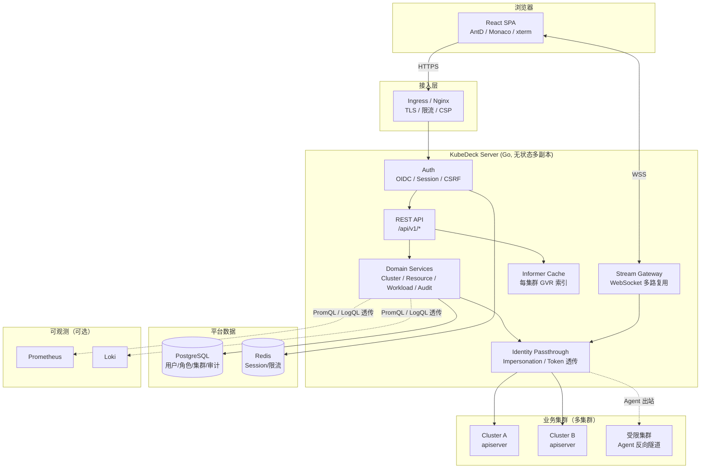

# K8S 管理控制台设计方案（KubeDeck）

| 项目 | 内容 |
|---|---|
| 文档版本 | v1.0 |
| 日期 | 2026-11-12 |
| 状态 | 设计评审（待评审通过后进入 Phase 0） |
| 形态 | B/S Web 管理控制台 |
| 建议技术栈 | 后端 Go + client-go，前端 React + TypeScript |

---

## 1. 背景与定位

### 1.1 解决什么问题

团队里不同角色对 K8S 的操作能力差异很大：研发只想看自己服务的 Pod 日志、改副本数；测试想快速拉起一套环境；运维要做全集群巡检。目前的方式是发 kubeconfig + 教 kubectl，结果是凭据扩散、误操作不可追溯、新人上手成本高。

KubeDeck 的目标是**把集群操作收敛到一个可控、可审计、有权限边界的 Web 界面上**。

### 1.2 明确不做什么

边界清晰比功能多更重要，以下需求一律引导到别的工具：

| 不做 | 原因 / 替代 |
|---|---|
| 替代 kubectl 的全部能力 | 保持 80% 高频场景覆盖，复杂操作给 YAML 直编 / 跳转 kubectl |
| CI/CD 流水线 | 与 GitLab CI / Argo CD 集成，不做自研发布系统 |
| 服务网格控制面 | 不接管 Istio/Linkerd，只展示其 CRD |
| 集群生命周期管理（装集群、扩节点） | 交给 Cluster API / 云厂商控制台 |
| 通用监控平台 | 复用 Prometheus + Grafana，做嵌入式视图 |

### 1.3 目标用户与核心场景

| 角色 | 核心诉求 | 权限边界 |
|---|---|---|
| 平台管理员 | 接集群、管用户、看审计 | 全局 |
| 集群管理员 | 集群内全量排障、节点与配额 | 单集群全部命名空间 |
| 应用开发者 | 看日志、改配置、重启、扩缩容 | 指定 namespace 读写 |
| 只读观察者（测试/值班） | 看状态、看事件、看日志 | 指定 namespace 只读 |

MVP 必须覆盖的 8 个场景：

1. 登录后看到"我能访问的集群 / 命名空间"
2. 工作负载列表 + 状态聚合（就绪/异常副本数）
3. Pod 详情：状态、容器、事件、日志、终端
4. 实时日志 tail 与关键字过滤
5. Deployment 伸缩 / 重启 / 镜像更新 / 回滚
6. YAML 查看、编辑、Diff 后提交
7. 资源事件与关联资源（Pod → Service → Ingress）
8. 所有写操作可审计、可回溯

---

## 2. 技术选型

### 2.1 后端语言：Go vs Python

结论：**选 Go**。但这个结论有前提，下面把差异说清楚，方便你推翻。

| 维度 | Go + client-go | Python + kubernetes SDK | 对项目的实际影响 |
|---|---|---|---|
| K8S SDK 成熟度 | 官方维护，与 apiserver 版本同步 | 官方生成式客户端，功能齐全但更新滞后 | Go 在新 API / CRD 上踩坑更少 |
| Watch / 长连接 | informer 机制，天然支持断线重连、resourceVersion 续传、本地缓存 | 需自建 watch 循环与重连逻辑，asyncio 下易出连接泄漏 | 实时列表页是核心体验，Go 少写约 40% 的胶水代码 |
| 本地缓存 | SharedInformer + Indexer，列表页可走缓存，不打 apiserver | 无等价机制，要么直连 apiserver，要么自己写缓存 | 50k Pod 的集群，直连 list 会打爆 apiserver |
| 并发模型 | goroutine，每路日志/exec 一个协程，成本极低 | asyncio 可用，但 CPU 密集（YAML 转换、Diff）会阻塞事件循环 | 终端 + 日志流并发是刚需 |
| 内存占用 | 单实例 ~80–150MB | ~250–400MB（含解释器与依赖） | 影响部署密度，非决定性 |
| 部署形态 | 单二进制 + 前端 embed，无运行时依赖 | 需解释器或容器镜像，依赖管理更重 | Go 交付更简单 |
| 开发效率 | 中等，样板代码多（泛型后可缓解） | 高，动态语言迭代快 | Python 在早期原型阶段更快 |
| 团队门槛 | 需懂 goroutine / channel / context | 大多数后端都会 | 取决于团队构成 |
| 二进制体积 / 启动 | ~40MB，启动 <1s | 镜像 ~200MB+，启动 3–5s | 滚动升级体验更好 |

**什么情况下应该选 Python：**

- 团队 5 人以内且全是 Python 背景，Go 的隐式学习成本会拖慢 1–2 个月；
- 只管理 1–3 个小集群（<500 Pod），QPS 低，实时性要求是"秒级"而非"亚秒级"；
- 这个工具只是内部临时平台，预期寿命 <1 年，优先速度而非长期维护；
- 需要重度复用已有的 Python 数据/AI 生态（如异常检测模型）。

即便如此，也建议**后端 Go、脚本与运维工具 Python**，而不是全 Python——因为 WebSocket 日志流和 exec 这两块，Python 实现的运维成本会持续存在。

### 2.2 最终技术栈

| 层 | 选型 | 说明 |
|---|---|---|
| 后端语言 | Go 1.23+ | 单二进制交付 |
| K8S 客户端 | client-go（dynamic + discovery + informer） | 统一用 dynamic client 处理 CRD，避免为每个类型生成 typed client |
| HTTP 框架 | chi 或 gin（建议 chi，贴近标准库） | 中间件生态够用 |
| WebSocket | gorilla/websocket 或 coder/websocket | 日志、exec、事件推送 |
| 数据库 | PostgreSQL 15+ | 只存平台自身数据，不存集群资源状态 |
| 缓存 / 会话 | Redis 7+ | 会话、限流、分布式锁（可选，单实例可省） |
| 认证 | OIDC（Keycloak / Dex / 飞书 / 企业 IdP） | 不自研密码体系 |
| 前端 | React 18 + TypeScript + Vite | — |
| UI 组件 | Ant Design 5 | 中后台场景组件最全 |
| 服务端状态 | TanStack Query v5 | 缓存、轮询、失效重取 |
| 客户端状态 | Zustand | 轻量，避免 Redux 样板 |
| YAML 编辑器 | Monaco Editor + YAML language service | 语法高亮、Schema 校验、Diff |
| 终端 | xterm.js | 配合后端 exec 流 |
| 图表 | ECharts | 资源趋势、拓扑 |
| 图表库 | @xyflow/react | 资源关系拓扑（V2） |
| 部署 | Helm Chart + 容器镜像 | 平台自身也跑在 K8S 上 |

> 关键决策：**后端不引入 ORM**。用 sqlc 或 squirrel 生成/拼 SQL，DDL 走 migrate 工具。表少（约 10 张），ORM 带来的隐式行为弊大于利。

---

## 3. 总体架构

### 3.1 架构图



### 3.2 分层职责

| 层 | 职责 | 不做什么 |
|---|---|---|
| 接入层 | TLS 终止、限流、静态资源、安全响应头 | 不做业务鉴权 |
| API 层 | 参数校验、身份注入、错误映射、审计埋点 | 不直接拼 K8S 请求 |
| 领域层 | 集群、资源、工作负载、审计的用例编排 | 不关心 HTTP |
| 适配层 | client-go 封装、informer、存储、Prometheus 客户端 | 不包含业务规则 |

### 3.3 部署形态

两种交付方式，均支持：

1. **All-in-One**：`go:embed` 把前端 `dist` 打进二进制，单容器部署，适合内网小团队。
2. **前后端分离**：前端走 CDN/Nginx，后端纯 API，适合大团队与多环境。

平台自身以 Helm Chart 部署在业务集群的独立 namespace（如 `kubedeck-system`），副本数 ≥2，无需 leader election 处理 API 请求；后台任务（健康巡检、缓存清理）用 Lease 选主。

---

## 4. 核心模块设计

### 4.1 多集群接入

#### 接入模式

| 模式 | 适用 | 实现 |
|---|---|---|
| Direct（直连） | 平台与集群网络互通 | 保存 kubeconfig，服务端构造 `rest.Config` 直连 apiserver |
| Agent（反向） | 集群在客户内网 / 无法入站 | 在目标集群部署轻量 Agent，主动向平台建 WSS 长连接，平台把请求封装成帧经隧道转发 |

MVP 只做 Direct，Agent 放到 V2。但**接口层要预留**：`ClusterTransport` 接口，Direct 与 Agent 是两种实现，上层无感知。

> **已确认（2026-11-12）**：当前没有必须接管的隔离集群，Phase 0 只实现 Direct；Agent 仅保留 `ClusterTransport` 接口与配置字段，不写隧道实现。

#### 凭据管理

- kubeconfig 中的 client-key / token 使用 **AES-256-GCM** 加密后入库；
- 主密钥（KEK）来自环境变量 / KMS / Vault，**绝不入库**；
- 每条凭据带 `key_version`，支持主密钥轮换（后台任务用旧密钥解密、新密钥加密）；
- 凭据只在连接建立时解密进内存，不落日志、不进 HTTP 响应（API 返回脱敏后的 `server` 与 `auth_type`）。

#### 集群健康

- 每 30s 调 `/readyz` + `/version`，记录 `status`、`latency_ms`、`server_version`；
- 连续 3 次失败标记 `Unreachable`，前端降级为只读历史快照并提示；
- 集群列表页展示版本、节点数、Pod 总数（来自 informer 缓存，不额外打 apiserver）。

### 4.2 认证与授权

这是整个系统最需要想清楚的部分。设计原则：**权限的单一事实来源是 K8S 原生 RBAC，平台只做"身份映射"和"入口收敛"**。

#### 认证

| 方式 | 说明 |
|---|---|
| OIDC（推荐） | 授权码 + PKCE，登录后建立平台 Session（HttpOnly + Secure + SameSite=Lax Cookie） |
| 本地账号 | 仅用于平台管理员初始化 / IdP 故障兜底，密码 Argon2id，强制 MFA 可选 |
| kubeconfig 直传 | 仅"自带凭据"模式，用于临时接入，默认关闭 |

不自研注册、找回密码、短信验证码——全部交给 IdP。

#### 授权：双层模型

```
用户请求
   │
   ├─ 平台层：这个用户能不能进这个集群 / 这个 namespace？
   │    （PostgreSQL 中的 role_binding，粒度：user × cluster × namespace × role）
   │
   └─ 集群层：这个用户能不能对这个资源做这个动作？
        （透传身份给 apiserver，由 K8S RBAC 判定）
```

**身份透传的两种实现：**

1. **Token 透传（优先）**：集群 apiserver 已配置 OIDC，直接把用户 ID Token 放进 `Authorization` 头。零信任链，最干净。
2. **Impersonation（通用）**：平台用高权限 ServiceAccount 发起请求，附带
   `Impersonate-User: <user-email>`、`Impersonate-Group: <groups>`。
   - 平台 SA 只需 `impersonate` 动词权限，**不需要** `cluster-admin`；
   - apiserver 会以被模拟用户身份走完整 RBAC + Admission；
   - 审计日志里记录的是真实用户。

> 注意：Impersonation 依赖 apiserver 的 `--enable-impersonation`（默认开启），且平台 SA 的 ClusterRole 必须能在 `users`、`groups`、`serviceaccounts` 资源上 `impersonate`。这项权限本身很敏感，需配合 NetworkPolicy 与审计。

> **已确认（2026-11-12）**：采用 **Impersonation 作为默认授权方式**，平台不自建 K8S 权限映射表；Token 透传（集群已配 OIDC 时）保留为可选优化项，不在 MVP 实现。前端只做按钮级可见性，服务端每个请求仍走 `SelfSubjectAccessReview` 预检 + apiserver 实际鉴权。

#### 权限预检与前端按钮

- 后端提供 `POST /api/v1/auth/can`，入参 `{cluster, namespace, verb, group, resource, name?}`；
- 实现用 `SelfSubjectAccessReview`（以当前用户身份批量探测），结果缓存 30s；
- 前端用 `<Can verb="delete" resource="pods">` 包裹危险按钮，无权限直接不渲染；
- **前端隐藏只是体验优化，后端每个请求仍必须重新校验**——永远不要相信前端。

#### 角色模型

| 平台角色 | 平台能力 | 映射到 K8S |
|---|---|---|
| PlatformAdmin | 管集群/用户/全部集群只读 | cluster-admin（仅用于运维排障，需二次审批） |
| ClusterAdmin | 单集群全命名空间读写 | 预置 ClusterRole |
| Developer | 指定 namespace 读写 | 预置 Role（deployments/pods/logs/exec 等） |
| Viewer | 指定 namespace 只读 | 预置 Role（get/list/watch） |

平台角色与 K8S Role 的绑定关系存 PG，但**不复制 K8S 的权限规则**，只存"给谁、在哪个范围、绑哪个预置角色"。

### 4.3 资源管理

#### 动态资源发现

- 启动时与每 5 分钟调用 `discovery.ServerPreferredResources`，缓存 GVR ↔ Kind ↔ 是否命名空间级 ↔ 支持的 verb；
- 所有资源操作走 `dynamic.Interface`，不为每个内置类型写 typed client；
- 提供"API 资源浏览器"，展示集群里所有可用的 Group/Version/Resource（含 CRD），让用户能操作任意 CRD。

#### 通用 CRUD

| 能力 | 说明 |
|---|---|
| List | 支持 labelSelector / fieldSelector / limit-continue 分页；默认走 informer 缓存，需要强一致时传 `?consistency=strong` 直连 apiserver |
| Get | 返回对象 + 关联事件 + ownerReferences 链 |
| Create / Update | 支持 JSON 与 YAML，`Content-Type: application/yaml` 直接透传；`?dryRun=All` 做预检 |
| Patch | 支持 `application/merge-patch+json`、`application/strategic-merge-patch+json`、`application/apply-patch+yaml`（SSA） |
| Delete | 支持 `propagationPolicy`（Foreground/Background/Orphan），默认 Foreground |
| Scale | 走 `scale` 子资源，避免与 Deployment 主体更新冲突 |

#### YAML 编辑体验

1. Monaco 加载 YAML Schema（从集群 OpenAPI v3 拉取并裁剪），实时标红未知字段与类型错误；
2. 提交前展示 **Diff 视图**（原对象 vs 新对象），只允许提交有变化的字段；
3. 对不可变字段（如 Deployment 的 `selector`）在提交前提示，避免"提交后才 422"；
4. 提交走 SSA 还是 Update 由资源类型决定，默认 Update + `resourceVersion` 乐观锁，冲突时提示刷新。

#### 资源关系

- 一级关系：`ownerReferences`（Deployment → ReplicaSet → Pod）；
- 二级关系：Service → Endpoints → Pod（按 selector 匹配）、Ingress → Service、PVC → Pod；
- 以"资源详情侧栏 + 简化拓扑图"呈现，V2 再上完整画布。

### 4.4 工作负载

| 资源 | 专属能力 |
|---|---|
| Deployment | 副本数、镜像、滚动策略、暂停/恢复、重启（改 `restartAt` 注解）、回滚到指定 revision、查看 ReplicaSet 历史 |
| StatefulSet | 副本数、分区更新、Pod 有序重启、PVC 列表 |
| DaemonSet | 节点覆盖率、滚动更新状态 |
| Job | 重跑、查看完成/失败 Pod、日志聚合 |
| CronJob | 手动触发（创建 Job）、挂起/恢复、下次执行时间 |
| Pod | 日志、终端、端口转发、删除/驱逐、资源用量、所在节点 |
| HPA | 当前/目标副本、指标曲线、扩缩容事件 |

**重启 Deployment 的实现**：不要 `kubectl rollout restart` 的等价物去 patch spec（会触发新的 revision），而是给 Pod Template 加 `kubedeck.io/restartedAt` 注解——与 kubectl 行为一致。

### 4.5 可观测性

| 数据源 | 用途 | 实现 |
|---|---|---|
| metrics-server（`metrics.k8s.io/v1beta1`） | 实时 CPU/Mem（节点、Pod、容器） | 直连 apiserver 聚合 API，10s 轮询 |
| Prometheus（可选） | 历史趋势、自定义 PromQL | 后端做 Query 代理，限制可用指标白名单 |
| Pod 日志 | 排障主入口 | 见 4.7 |
| Events | 状态变化、异常原因 | informer watch + 前端按 reason 过滤 |
| 节点 | 状态、容量、污点、Pod 密度 | core/v1 nodes |

**巡检 / 健康评分（V2）**：规则引擎跑一批静态检查，输出可行动的告警：

- 容器未设置 requests/limits
- 单副本 + 无 PDB 的关键工作负载
- 镜像 tag 为 `latest` 或无 digest
- Pod 处于 Pending / CrashLoopBackOff 超过 N 分钟
- Service selector 匹配不到任何 Pod
- 证书类 Secret 临近过期

### 4.6 实时推送

**为什么不用轮询**：列表页 5s 轮询在 5000 Pod 规模下会持续打 apiserver，且体验是"跳变"的。

#### 设计

- 每个集群为高频 GVR（pods/deployments/events/nodes）维护一个 `SharedInformer`；
- 前端通过**一条** WebSocket 连接订阅多个资源视图（多路复用），而不是每个列表页开一条 WS；
- 服务端把 informer 的 Add/Update/Delete 转成增量帧，按 `namespace + labelSelector` 过滤后推送；
- **慢消费者保护**：每连接一个有界队列（如 1000 帧），满了就丢弃增量并下发 `resync` 指令，让客户端重新拉全量；
- 只推摘要字段（name/namespace/status/replicas/age），详情按需拉，控制带宽。

#### 协议帧

```json
// C -> S 订阅
{"type":"subscribe","id":"s1","cluster":"prod","gvr":"apps/v1/deployments","namespace":"default","selector":"app=web"}

// S -> C 增量
{"type":"event","id":"s1","event":"MODIFIED","object":{"name":"web","namespace":"default","ready":"2/3","age":"3d"}}

// S -> C 要求重同步
{"type":"resync","id":"s1"}

// C -> S 心跳
{"type":"ping","ts":1730000000}
```

断线重连后客户端带 `lastResourceVersion` 重新 subscribe，服务端能续传则续传，否则回 `resync`。

### 4.7 终端与日志流

#### 日志

- `GET /api/v1/clusters/{c}/namespaces/{ns}/pods/{pod}/log?container=x&follow=true&tailLines=500`
- 后端以 SSE 或 WebSocket 分帧输出，前端 xterm/自定义 LogViewer 渲染；
- 支持：多容器切换、时间戳、关键字高亮、暂停滚动、下载（限大小）、上一个容器（`previous=true`）；
- 大集群建议接入 Loki，后端做 LogQL 代理，避免"日志量大时 apiserver 拉流超时"。

#### Exec

```
浏览器 xterm.js
   │  WSS（自定义二进制帧：0x00 stdin / 0x01 stdout / 0x02 resize）
   ▼
KubeDeck Stream Gateway
   │  remotecommand.NewSPDYExecutor（client-go <1.31）
   │  或 remotecommand.NewWebSocketExecutor（client-go >=1.30，推荐）
   ▼
apiserver /pods/{name}/exec
```

要点：

- 每次 exec 都记审计（用户、Pod、容器、命令、开始/结束时间、退出码）；
- 可选会话录制：把 stdin/stdout 按时间戳写入对象存储，满足合规；
- 终端默认只允许 `sh/bash`，禁止交互式高危工具需要单独审批（可配置）；
- 空闲 15 分钟自动断开；
- exec 不受普通 RBAC 覆盖时，用 `pods/exec` 子资源的 `create` 动词校验，这正是 K8S 原生模型。

### 4.8 Helm 与应用（V2）

- Release 列表 / 详情 / values / manifest / 历史；
- 安装、升级、回滚：后端调用 Helm SDK（不是 shell 调 `helm`），Release 状态存 Secret（Helm 默认行为，不复制到 PG）；
- 应用模板市场：预置 values schema + 表单化配置，降低"填错 YAML"的概率；
- 与 GitOps（Argo CD）联动：展示 Argo Application 同步状态，写操作引导到 Git。

### 4.9 审计与合规

审计是这类工具的**立身之本**，不是附加功能。

记录范围：

| 事件 | 记录内容 |
|---|---|
| 所有写操作（create/update/patch/delete/scale） | 用户、集群、GVR、namespace/name、请求体 SHA256、结果码、耗时 |
| exec / port-forward | 目标 Pod、容器、命令、会话时长、退出码 |
| 认证 | 登录成功/失败、IP、UA |
| 权限变更 | 谁给谁加了什么角色 |
| 凭据操作 | 集群接入/删除/凭据轮换（不记录凭据内容） |

实现：

- 审计中间件在 handler 层生成结构化事件，异步写入 PG（批量 insert，避免拖慢请求）；
- 表按月分区，保留 180 天（可配置），冷数据归档到对象存储；
- 审计记录**只追加**，数据库账号无 UPDATE/DELETE 权限；提供哈希链（每条记录包含前一条的 hash）用于防篡改校验；
- 可选：接入 K8S 原生 audit webhook，把 apiserver 侧审计也收进来，形成双视角。

### 4.10 平台管理

- 用户与角色：列出 IdP 同步来的用户，分配集群/命名空间绑定；
- 集群配额视图：namespace 的 ResourceQuota / LimitRange 使用率；
- 系统公告与维护窗口；
- 平台自身的健康页：各集群连通性、informer 同步状态、队列积压。

---

## 5. 数据模型

原则：**PG 只存平台元数据，绝不镜像集群资源状态**。集群资源以 informer 缓存和 apiserver 为准，避免双写不一致。

### 5.1 核心表

```sql
-- 用户（OIDC 首次登录时 upsert）
CREATE TABLE users (
    id            BIGSERIAL PRIMARY KEY,
    subject       TEXT NOT NULL UNIQUE,        -- OIDC sub
    email         TEXT NOT NULL,
    display_name  TEXT NOT NULL,
    source        TEXT NOT NULL,               -- oidc | local
    is_platform_admin BOOLEAN NOT NULL DEFAULT FALSE,
    status        TEXT NOT NULL DEFAULT 'active',
    created_at    TIMESTAMPTZ NOT NULL DEFAULT now(),
    last_login_at TIMESTAMPTZ
);

-- 集群
CREATE TABLE clusters (
    id            BIGSERIAL PRIMARY KEY,
    name          TEXT NOT NULL UNIQUE,
    display_name  TEXT NOT NULL,
    server        TEXT NOT NULL,
    transport     TEXT NOT NULL DEFAULT 'direct',   -- direct | agent
    auth_mode     TEXT NOT NULL,                    -- token-passthrough | impersonation
    ca_cert       BYTEA,
    credential_id BIGINT REFERENCES cluster_credentials(id),
    labels        JSONB NOT NULL DEFAULT '{}',
    status        TEXT NOT NULL DEFAULT 'unknown',
    last_seen_at  TIMESTAMPTZ,
    created_by    BIGINT REFERENCES users(id),
    created_at    TIMESTAMPTZ NOT NULL DEFAULT now()
);

-- 凭据（密文）
CREATE TABLE cluster_credentials (
    id           BIGSERIAL PRIMARY KEY,
    ciphertext   BYTEA NOT NULL,               -- AES-256-GCM
    nonce        BYTEA NOT NULL,
    key_version  INT NOT NULL,
    auth_type    TEXT NOT NULL,                -- kubeconfig | token | client-cert
    fingerprint  TEXT NOT NULL,                -- 用于轮换比对，不可逆
    rotated_at   TIMESTAMPTZ NOT NULL DEFAULT now(),
    expires_at   TIMESTAMPTZ
);

-- 平台角色（预置，不可删除）
CREATE TABLE roles (
    id          BIGSERIAL PRIMARY KEY,
    code        TEXT NOT NULL UNIQUE,          -- platform_admin / cluster_admin / developer / viewer
    name        TEXT NOT NULL,
    permissions JSONB NOT NULL                 -- 平台级能力位，不复制 K8S 规则
);

-- 绑定：用户 × 集群 × 命名空间 × 角色
CREATE TABLE role_bindings (
    id         BIGSERIAL PRIMARY KEY,
    user_id    BIGINT NOT NULL REFERENCES users(id),
    cluster_id BIGINT NOT NULL REFERENCES clusters(id),
    namespace  TEXT NOT NULL DEFAULT '*',      -- '*' 表示全命名空间
    role_id    BIGINT NOT NULL REFERENCES roles(id),
    granted_by BIGINT REFERENCES users(id),
    created_at TIMESTAMPTZ NOT NULL DEFAULT now(),
    UNIQUE (user_id, cluster_id, namespace, role_id)
);

-- 审计（按月分区）
CREATE TABLE audit_logs (
    id           BIGSERIAL,
    occurred_at  TIMESTAMPTZ NOT NULL,
    actor_id     BIGINT,
    actor_email  TEXT NOT NULL,
    cluster_id   BIGINT,
    verb         TEXT NOT NULL,
    api_group    TEXT,
    resource     TEXT,
    namespace    TEXT,
    name         TEXT,
    result_code  INT,
    latency_ms   INT,
    client_ip    INET,
    user_agent   TEXT,
    detail       JSONB,                        -- 命令、diff 摘要、dryRun 等
    prev_hash    TEXT,
    hash         TEXT NOT NULL,
    PRIMARY KEY (id, occurred_at)
) PARTITION BY RANGE (occurred_at);

-- 操作模板（如"重启 / 扩容 / 导出配置"）
CREATE TABLE operation_templates (
    id          BIGSERIAL PRIMARY KEY,
    name        TEXT NOT NULL,
    scope       TEXT NOT NULL,                 -- platform | cluster | namespace
    payload     JSONB NOT NULL,
    created_by  BIGINT REFERENCES users(id),
    created_at  TIMESTAMPTZ NOT NULL DEFAULT now()
);
```

其他表：`sessions`（或放 Redis）、`cluster_health_samples`（保留 7 天，用于连通性曲线）、`app_settings`、`agent_tokens`（V2）。

### 5.2 缓存策略

| 数据 | 位置 | TTL / 失效 |
|---|---|---|
| 用户权限集合 | Redis | 5 分钟，权限变更主动失效 |
| `SelfSubjectAccessReview` 结果 | 进程内 LRU | 30 秒 |
| API 资源发现（GVR） | 进程内 | 5 分钟 |
| 集群资源列表 | informer 缓存 | watch 驱动 |
| 集群健康 | PG + 内存 | 30 秒刷新 |

---

## 6. API 设计

### 6.1 通用约定

- Base path：`/api/v1`
- 认证：Session Cookie（Web）+ `Authorization: Bearer <token>`（CLI/自动化，V2）
- 所有响应 `Content-Type: application/json`，流式接口除外
- 错误结构统一：

```json
{
  "code": "FORBIDDEN",
  "message": "user cannot delete pods in namespace prod",
  "details": {"reason":"RBAC","resource":"pods","namespace":"prod"},
  "requestId": "01J..."
}
```

- 分页：`?limit=50&continue=<token>`，响应带 `continue`、`remainingItemCount`
- 幂等：写操作支持 `Idempotency-Key` 头（Redis 存 24h）
- 版本：URL 版本号；破坏性变更走 `/api/v2`

### 6.2 关键接口

| 方法 | 路径 | 说明 |
|---|---|---|
| POST | `/auth/login` | OIDC 回调后换取 Session（或直接跳转） |
| POST | `/auth/logout` | 注销 |
| GET | `/auth/me` | 当前用户 + 可访问集群/命名空间 |
| POST | `/auth/can` | 批量权限预检 |
| GET | `/clusters` | 集群列表（含状态、版本、资源统计） |
| POST | `/clusters` | 接入集群（kubeconfig / token） |
| GET | `/clusters/{id}` | 集群详情 |
| DELETE | `/clusters/{id}` | 移除集群（需二次确认） |
| GET | `/clusters/{id}/health` | 连通性、组件状态 |
| GET | `/clusters/{id}/api-resources` | 可用 GVR 列表 |
| GET | `/clusters/{id}/namespaces` | 命名空间列表 |
| GET | `/clusters/{id}/resources/{group}/{version}/{resource}` | 列表（`group` 为 `_` 表示 core） |
| POST | `/clusters/{id}/resources/...` | 创建 |
| GET/PUT/PATCH/DELETE | `/clusters/{id}/resources/.../{name}` | 单资源 |
| GET | `/clusters/{id}/resources/.../{name}/events` | 关联事件 |
| GET | `/clusters/{id}/resources/.../{name}/yaml` | YAML 导出 |
| POST | `/clusters/{id}/resources/.../{name}/scale` | 伸缩 |
| GET | `/clusters/{id}/workloads/deployments/{name}/revisions` | 历史版本 |
| POST | `/clusters/{id}/workloads/deployments/{name}/rollback` | 回滚 |
| POST | `/clusters/{id}/workloads/deployments/{name}/restart` | 重启 |
| GET | `/clusters/{id}/pods/{ns}/{pod}/log` | 日志（`follow=true` 走流式） |
| GET | `/clusters/{id}/pods/{ns}/{pod}/metrics` | 实时指标 |
| GET | `/clusters/{id}/audit-logs` | 审计查询（管理员） |
| GET | `/clusters/{id}/scan` | 巡检报告（V2） |
| WS | `/clusters/{id}/stream` | 多路复用实时通道 |
| WS | `/clusters/{id}/exec` | 终端 |

> 资源路径使用 `{group}/{version}/{resource}` 而非 `{kind}`，因为 CRD 的 Kind 与 resource 名不总是一致；前端通过 `/api-resources` 拿到映射。

### 6.3 流式接口约定

| 场景 | 协议 | 原因 |
|---|---|---|
| 日志 follow | SSE 或 WebSocket | 单向、文本，SSE 更简单；需要双向控制时用 WS |
| 终端 exec | WebSocket（二进制帧） | 需要 stdin、stdout、resize 双向 |
| 列表实时更新 | WebSocket | 多路复用、心跳 |
| 大文件下载（日志导出） | HTTP Range | 走普通下载，不占 WS |

---

## 7. 前端设计

### 7.1 路由与页面

```
/login
/                                   → 集群总览（我有权限的集群卡片）
/clusters/:cluster/overview         → 集群概览（节点、容量、异常工作负载）
/clusters/:cluster/nodes
/clusters/:cluster/namespaces
/clusters/:cluster/workloads/:kind  → deployments | statefulsets | daemonsets | jobs | cronjobs
/clusters/:cluster/pods             → 列表（可按 ns/label/状态过滤）
/clusters/:cluster/pods/:ns/:name   → 详情（概览/日志/终端/事件/YAML）
/clusters/:cluster/config/:kind     → configmaps | secrets | serviceaccounts | hpa | pdb
/clusters/:cluster/network/:kind    → services | ingresses | endpoints | networkpolicies
/clusters/:cluster/storage/:kind    → pvcs | pvs | storageclasses
/clusters/:cluster/custom/:group/:version/:resource  → 任意 CRD
/clusters/:cluster/events
/clusters/:cluster/audit            → 审计（管理员）
/settings/clusters | /settings/users | /settings/roles
```

### 7.2 页面通用结构

中后台的标准三栏：左侧集群/命名空间上下文 + 主导航，顶部全局搜索与命令面板（`⌘K`），右侧详情抽屉。列表页统一具备：

- 列配置与记忆（localStorage）
- 过滤器持久化到 URL（可分享链接）
- 批量选择 + 批量操作（带权限判断）
- 空态/错误态/骨架屏
- 自动刷新开关（默认开，走 WS 增量）

### 7.3 状态管理边界

| 状态类型 | 工具 | 例子 |
|---|---|---|
| 服务端状态 | TanStack Query | 资源列表、详情、权限 |
| 实时增量 | WS 事件 → `queryClient.setQueryData` 局部更新 | Pod 状态变化 |
| UI 状态 | Zustand | 侧栏折叠、当前 namespace、表格列配置 |
| 表单状态 | React Hook Form + Zod | YAML 表单、集群接入 |

**不要**把资源列表塞进全局 store——那会立刻退化成手写缓存。

### 7.4 关键组件

| 组件 | 职责 |
|---|---|
| `<ResourceTable>` | 泛型列表：列定义、排序、过滤、分页、批量操作、WS 增量 |
| `<YamlEditor>` | Monaco + Schema 校验 + Diff + 提交前预检 |
| `<LogViewer>` | 虚拟滚动、暂停、搜索高亮、下载、多容器切换 |
| `<Terminal>` | xterm.js + 尺寸同步 + 断线重连提示 |
| `<EventTimeline>` | 按时间倒序、reason 着色、关联资源跳转 |
| `<TopologyGraph>` | ownerRef/selector 关系（V2） |
| `<Can>` | 按钮级权限守卫 |
| `<DangerConfirm>` | 危险操作确认：要求输入资源名，展示影响面 |

### 7.5 性能

- 列表超过 200 行启用虚拟滚动（TanStack Virtual）；
- WS 增量做 100–200ms 的批合并，避免高频 setState；
- Monaco、xterm、拓扑库全部动态 import，首屏只加载列表与详情；
- 路由级代码分割 + 预取（hover 预加载）。

---

## 8. 安全设计

### 8.1 威胁模型（STRIDE 摘要）

| 威胁 | 场景 | 缓解 |
|---|---|---|
| Spoofing | 伪造 Session / 越权访问他集群 | HttpOnly Cookie + 服务端 Session；cluster_id 每次校验绑定关系 |
| Tampering | 篡改请求参数越权操作别的 namespace | 服务端从绑定关系推导授权范围，**不信任前端传的 namespace** |
| Repudiation | 否认删除了生产 Deployment | 不可变审计 + 哈希链 |
| Information disclosure | 凭据泄露、Secret 明文展示 | 凭据 AES-GCM 加密；Secret 默认掩码，查看需二次确认并审计 |
| Denial of service | 大集群全量 list 打爆 apiserver | 缓存优先、强制分页、每用户限流、informer 限流 |
| Elevation of privilege | 通过 exec 进入 Pod 拿到集群权限 | exec 单独授权 + 审计 + 可选审批；Pod 安全上下文由集群侧约束 |

### 8.2 关键控制点

1. **凭据**：只在内存中解密；不写日志；HTTP 响应脱敏；支持轮换与吊销。
2. **SSRF**：集群 `server` 地址仅平台管理员可填，且校验必须为 `https://`；禁止内网元数据地址段（169.254.0.0/16）。
3. **注入**：GVR、namespace、name 全部用正则白名单校验；SQL 全参数化；YAML 解析禁用自定义 tag。
4. **XSS**：React 默认转义；YAML/日志渲染一律文本节点，不用 `dangerouslySetInnerHTML`。
5. **CSRF**：Cookie 加 `SameSite=Lax`；非 GET 请求校验 `Origin`/`Referer` + 双提交 Token。
6. **CSP**：`default-src 'self'`，禁用内联脚本（Vite 构建可满足）。
7. **响应头**：HSTS、`X-Content-Type-Options: nosniff`、`X-Frame-Options: DENY`。
8. **限流**：登录 5 次/分钟/IP；列表 30 QPS/用户；WS 连接数每用户 ≤5；exec 并发 ≤2。
9. **最小权限**：平台 SA 只给 `impersonate` + 必要的 discovery 权限；**不挂 cluster-admin**。
10. **网络**：平台到 apiserver 走 TLS 双向校验（ca_cert 必填）；平台 Pod 配 NetworkPolicy 只出站到 apiserver 与 PG/Redis。

### 8.3 危险操作清单（必须二次确认 + 审计）

- 删除 Namespace / PV / PVC / CRD / Node
- 删除或驱逐生产命名空间的 Pod
- 修改 Deployment 镜像 / 副本数为 0
- 查看 Secret 明文
- exec 进入生产 Pod
- 修改集群凭据、授权变更

---

## 9. 非功能设计

### 9.1 性能指标

| 指标 | 目标 |
|---|---|
| 资源列表 P95（缓存命中） | < 300ms |
| 资源详情 P95 | < 500ms |
| 集群总览首屏 | < 2s |
| WS 事件端到端延迟 | < 1s（P95） |
| 日志首字节 | < 1.5s |
| 支持规模 | 单集群 1000 节点 / 50k Pod / 20 集群 |

### 9.2 内存与 apiserver 压力

- informer 只缓存**摘要字段**：用 `metav1.PartialObjectMetadata` + `metadata` 级别的 list/watch，对象大小可降一个数量级；
- 详情页按需 `GET` 单个对象，不走缓存；
- 每集群 informer 只订阅"页面用得到的 GVR"，不做全量 informer；
- 用 `workqueue` + 限速器保护 apiserver，客户端 QPS/Burst 按集群单独配置（默认 50/100）；
- 大量集群场景（>20）考虑 **按访问热度懒加载 informer**：某集群 10 分钟无人访问则停止 watch，重新访问时先 list 再 watch。

### 9.3 可用性

- Server 无状态，≥2 副本，`PodDisruptionBudget: minAvailable: 1`；
- 后台任务（健康巡检、审计归档、密钥轮换）用 `Lease` 选主，避免重复执行；
- PG/Redis 故障时：只读页面尽量可用（informer 缓存仍在），写操作返回 503 并明确提示；
- 单集群不可达不影响其他集群（每集群独立的 client、informer、熔断器）。

### 9.4 可观测性（平台自身）

- `/metrics` 暴露：请求量/延迟/错误率、WS 连接数、informer 同步延迟、apiserver 请求 QPS、缓存命中率；
- 结构化 JSON 日志，带 `requestId`、`userId`（不记录请求体）；
- OpenTelemetry 链路：HTTP → 领域层 → apiserver 调用；
- 健康检查：`/healthz`（进程）、`/readyz`（PG + 至少一个集群可用）。

### 9.5 降级策略

| 故障 | 降级行为 |
|---|---|
| informer 失步 | 页面提示"数据可能延迟"，提供手动刷新 |
| metrics-server 不可用 | 隐藏监控图表，保留状态信息 |
| Prometheus 不可用 | 趋势图显示"暂不可用"，不影响核心操作 |
| Redis 不可用 | Session 回落到签名的无状态 Cookie（可配置），限流降级为本地令牌桶 |
| 某集群不可达 | 只影响该集群视图，顶部横幅提示 |

---

## 10. 部署方案

### 10.1 依赖组件

| 组件 | 必需 | 说明 |
|---|---|---|
| PostgreSQL 15+ | 是 | 平台元数据与审计；建议托管或独立实例 |
| Redis 7+ | 否（推荐） | Session、限流、幂等键；单副本时可省 |
| Prometheus | 否 | 历史指标与趋势 |
| Loki | 否 | 大集群日志聚合 |
| Ingress + cert-manager | 是 | TLS |

### 10.2 Helm Chart 结构

```
charts/kubedeck/
├── Chart.yaml
├── values.yaml
├── templates/
│   ├── deployment.yaml        # 2+ 副本，反亲和
│   ├── service.yaml
│   ├── ingress.yaml
│   ├── configmap.yaml
│   ├── secret.yaml            # 只存引用，不存明文
│   ├── serviceaccount.yaml    # 绑定 impersonate ClusterRole
│   ├── clusterrole.yaml
│   ├── pdb.yaml
│   ├── hpa.yaml
│   ├── networkpolicy.yaml
│   └── servicemonitor.yaml
└── crds/                      # 无（平台自身不引入 CRD）
```

关键 values：

```yaml
replicaCount: 2
image:
  repository: registry.example.com/kubedeck
  tag: v0.1.0
config:
  database:
    host: pg.example.com
    name: kubedeck
    existingSecret: kubedeck-db
  redis:
    enabled: true
    existingSecret: kubedeck-redis
  auth:
    mode: oidc
    issuer: https://sso.example.com/realms/main
    clientId: kubedeck
    existingSecret: kubedeck-oidc
  encryption:
    existingSecret: kubedeck-master-key   # 32 字节
  informer:
    eagerClusters: 5
    idleTimeout: 10m
resources:
  requests: {cpu: 200m, memory: 256Mi}
  limits:   {cpu: 2,    memory: 1Gi}
```

### 10.3 安装流程（概要）

1. 创建 namespace 与数据库；
2. 生成主密钥（`openssl rand -base64 32`）并写入 Secret；
3. 在 IdP 注册 OIDC 客户端，回调 `https://kubedeck.example.com/api/v1/auth/callback`；
4. `helm install kubedeck ./charts/kubedeck -f values-prod.yaml`；
5. 首个平台管理员通过 `kubedeck bootstrap-admin --email=...`（一次性 Job）指定；
6. 登录后在 UI 中接入业务集群（粘贴 kubeconfig），平台用 Impersonation 验证连通性。

---

## 11. 代码结构（Go 后端）

```
kubedeck/
├── cmd/
│   └── server/main.go
├── internal/
│   ├── api/                 # HTTP 层
│   │   ├── router.go
│   │   ├── middleware/      # auth, rbac, audit, ratelimit, recovery
│   │   └── handler/         # cluster, resource, workload, stream, audit
│   ├── domain/              # 领域服务（不依赖 HTTP）
│   │   ├── cluster/
│   │   ├── resource/
│   │   ├── workload/
│   │   └── audit/
│   ├── kube/                # K8S 适配层
│   │   ├── client_factory.go   # 每集群 client 复用
│   │   ├── discovery.go
│   │   ├── informer.go         # informer 生命周期 + 懒加载
│   │   ├── impersonation.go
│   │   ├── exec.go
│   │   └── logs.go
│   ├── store/               # PostgreSQL（sqlc 生成）
│   │   ├── queries/
│   │   └── migrations/
│   ├── auth/                # OIDC、session、权限预检
│   ├── crypto/              # AES-GCM、密钥轮换
│   └── config/
├── web/                     # 前端（Vite）
│   ├── src/
│   └── dist/                # 构建产物，go:embed
├── charts/kubedeck/
├── deploy/
└── Makefile
```

前端目录：

```
web/src/
├── app/            # 路由、布局、Providers
├── features/       # clusters / workloads / pods / network / storage / audit / settings
├── components/     # ResourceTable / YamlEditor / LogViewer / Terminal / Can
├── lib/            # api client、ws client、query keys、formatters
└── styles/
```

---

## 12. 迭代路线

假设 3 人（1 后端 + 1 前端 + 1 全栈/设计），按 2 周一个迭代。

| 阶段 | 周期 | 交付物 | 验收标准 |
|---|---|---|---|
| Phase 0 骨架 | 2 周 | 登录（OIDC）、集群接入（直连 + Impersonation）、资源列表/详情、YAML 只读、前端框架 | 能登录并浏览一个真实集群的 Pod 列表 |
| Phase 1 MVP | 6 周 | 通用 CRUD + YAML 编辑/Diff、Deployment 伸缩/重启/回滚、Pod 日志、Events、审计日志、权限预检 | 开发者可在自己 namespace 完成日常 80% 操作 |
| Phase 2 体验 | 6 周 | WS 实时增量、exec 终端（需先在本地 k3s/kind 验证）、多容器日志、指标图表、集群总览、资源关系、批量操作 | 列表无需手动刷新；终端可排障 |
| Phase 3 增强 | 8 周 | Helm 管理、巡检规则、拓扑图、Agent 模式、Prometheus/Loki 集成、会话录像 | 支持受限网络集群与合规审计 |
| Phase 4 规模化 | 持续 | 懒加载 informer、多租户、成本视图、审批流、开放 API | 20 集群 / 50k Pod 稳定运行 |

**裁剪建议**：如果只有 4–6 周预算，砍掉 Phase 2 的指标图表与资源关系图，用"跳转 Grafana"替代；exec 可以延后，日志必须先有。

---

## 13. 关键决策与风险

| # | 决策 | 备选 | 风险与应对 |
|---|---|---|---|
| 1 | 后端 Go | Python FastAPI | 团队 Go 经验不足 → 预留 2 周学习期；样板代码多 → 用 dynamic client 统一处理 |
| 2 | 权限用 Impersonation 透传 | 平台自建 RBAC 映射表 | 平台 SA 权限过大 → 只授 `impersonate`；排查困难 → 审计里记录被模拟身份 |
| 3 | 状态不入 PG，实时读 apiserver | 定期全量同步入库 | apiserver 压力 → informer 缓存 + 分页 + 懒加载；离线分析需求 → 后续接 Prometheus/数仓 |
| 4 | 通用 dynamic client 而非 typed client | 为常用类型写 typed | CRD 支持成本低；但字段类型丢失 → 前端按 schema 渲染，未知字段原样展示 |
| 5 | 不引入 ORM | GORM / Ent | 手写 SQL 维护成本 → 用 sqlc 生成类型安全代码 |
| 6 | 日志流不落平台存储 | 全量收集到 Loki | Loki 运维成本 → 只在大集群启用，小集群直连 apiserver |
| 7 | 前端 SPA 不做 SSR | Next.js | SEO 无需求；首屏 → 路由预取 + 骨架屏 |

**技术预研项（Phase 0 必须验证）：**

1. Impersonation 在目标集群是否可用，平台 SA 的最小 ClusterRole 到底需要哪些规则；
2. 目标集群规模下，metadata-only informer 的实际内存与 apiserver 压力；
3. client-go 版本与 apiserver 版本的兼容矩阵（建议 client-go 版本不低于 apiserver 最低支持版本）；
4. 浏览器端 exec 的 WebSocket 路径在现网 Ingress（含 nginx WS 升级、超时配置）下是否稳定。

---

## 14. 附录

### A. Go vs Python 快速决策表

| 如果你的情况是… | 选 |
|---|---|
| 计划长期维护、多集群、要 exec/日志流 | **Go** |
| 团队全是 Python、只做 1–2 个小集群、半年内上线 | Python（FastAPI + kubernetes SDK） |
| 需要把工具嵌入已有 Python 数据平台 | Python |
| 需要单二进制交付、给客户私有化部署 | **Go** |
| 想快速验证产品形态 | 先用 Python 做原型，验证后再用 Go 重写核心 |

### B. 术语

| 术语 | 含义 |
|---|---|
| GVR | Group/Version/Resource，K8S 资源的唯一寻址方式 |
| SSA | Server-Side Apply，服务端合并式更新 |
| informer | client-go 的本地缓存 + watch 机制 |
| Impersonation | apiserver 以指定用户身份执行请求的机制 |
| SSA/PDB/HPA | 服务端应用 / Pod 中断预算 / 水平自动扩缩容 |

### C. 参考实现

- Kubernetes Dashboard（功能参考，架构较老）
- Rancher UI（多集群与权限模型参考）
- Lens / OpenLens（桌面端交互参考）
- Headlamp（插件化架构参考）
- k9s（终端交互与信息密度参考）

---

## 15. 决策记录（已确认）

| 编号 | 决策项 | 结论 | 依据 | 影响 |
|---|---|---|---|---|
| D-01 | 后端语言 | **Go** | informer 缓存、长连接并发、单二进制交付 | 全案按 Go 设计；团队需具备 goroutine/context 基础 |
| D-02 | 授权模型 | **Impersonation 透传，听 K8S 的** | 权限单一事实来源，不维护双份规则 | 平台 SA 只需 `impersonate`；需在测试集群验证 |
| D-03 | exec 终端 | **Phase 2 交付，Phase 0 先做可行性验证** | 高危功能，必须有真实集群验证；开发者本地无 kubeconfig 时提前 | 先用 k3s/kind 打通链路，再决定是否提前到 Phase 1 |
| D-04 | 多集群接入 | **MVP 只做 Direct，预留 Agent 接口** | 当前无隔离集群 | `ClusterTransport` 抽象 + `transport` 配置字段 |
| D-05 | 测试环境 | **由开发侧自建（WSL2 + k3s），不依赖使用者本地环境** | 使用者本地无 K8S 环境 | 环境步骤固化在 `docs/local-environment.md`，可照做复现 |

### 本地环境现状（2026-11-12 探测）

| 工具 | 状态 | 说明 |
|---|---|---|
| Go | **1.27.4 已安装** | Windows `C:\Users\<你>\tools\go`；WSL `/usr/local/go` |
| Node / npm | v24.16.0 / 12.2.2 | 可用，Phase 0 前端使用 |
| kubectl | v1.36.1 | 可用 |
| Docker Desktop | 已安装，未使用 | 镜像加速走 containerd 配置，不依赖 Docker |
| WSL2 Ubuntu | **26.04，运行中** | 测试集群载体 |
| k3s | **v1.37.2+k3s1，节点 Ready** | 已配置 containerd 镜像加速 |

### 实施顺序

1. 搭测试环境：WSL2 Ubuntu 内装 k3s → 生成 kubeconfig → 本机 kubectl 连通；
2. Go 侧写三个最小验证程序：① list pods（dynamic client）② impersonation 模拟普通用户 ③ exec 进容器跑 `echo`；
3. 三项验证通过后再进入 Phase 0 脚手架，避免架构返工。

### 验证结果（2026-11-12，已全部通过）

环境：WSL2 Ubuntu 26.04 + k3s v1.37.2 + Go 1.27.4 + client-go v0.37.2。详细记录见 [verify/README.md](verify/README.md)。

| 验证项 | 结果 | 关键证据 |
|---|---|---|
| dynamic client 列 Pod | ✅ | 发现 27 个 API 组，成功列出 kube-system 4 个 Pod |
| Impersonation + RBAC | ✅ | 未授权 403 → 绑定 Role 后成功 → 跨 ns 403 → SSAR allowed |
| exec 进容器 | ✅ | 输出 `exec-ok` + 容器内 `id`，SPDY executor 在 1.37 可用 |

**验证中发现并已修正的设计缺陷**：`discovery.ServerPreferredResources()` 在任一聚合 API（本次为 metrics-server）不可用时会**整体失败**。Phase 0 起必须实现"部分发现失败可容忍"：

```go
rl, err := dc.ServerPreferredResources()
if err != nil && !discovery.IsGroupDiscoveryFailedError(err) {
    return err
}
// 用部分结果继续，UI 标注该 API 组暂不可用
```

**结论**：D-02（Impersonation）与 D-03（exec）均确认可行，无需回退方案。Phase 0 可以启动。

---

**下一步**：以 `verify/` 的三个程序为基线，搭建 Phase 0 骨架（HTTP 层 + 集群接入 + 资源列表/详情 + 前端框架）。生产接入前需为平台 SA 配置最小 `impersonate` ClusterRole（见 verify/README.md §2）。

---

## 附录 D：完整 API 清单

约定：`{c}` = 集群 ID，`{ns}` = 命名空间，`{g}/{v}/{r}` = group/version/resource（core 组的 group 用 `_` 占位）。所有接口默认要求已登录；「最低权限」列指该接口在平台层的准入要求。

### D.1 认证与用户

| 方法 | 路径 | 说明 | 最低权限 |
|---|---|---|---|
| GET | `/api/v1/auth/login` | 发起 OIDC 授权码流程（302 到 IdP） | 匿名 |
| GET | `/api/v1/auth/callback` | OIDC 回调，建立会话 | 匿名 |
| POST | `/api/v1/auth/logout` | 注销当前会话 | 登录 |
| GET | `/api/v1/auth/me` | 当前用户、角色、可访问集群与命名空间 | 登录 |
| POST | `/api/v1/auth/can` | 批量权限预检 | 登录 |
| POST | `/api/v1/auth/bootstrap` | 创建首个平台管理员（一次性） | 引导令牌 |

### D.2 集群

| 方法 | 路径 | 说明 | 最低权限 |
|---|---|---|---|
| GET | `/api/v1/clusters` | 集群列表（含状态、版本、资源计数） | 登录 |
| POST | `/api/v1/clusters` | 接入集群（kubeconfig / token） | PlatformAdmin |
| GET | `/api/v1/clusters/{c}` | 集群详情（凭据脱敏） | 绑定 |
| PATCH | `/api/v1/clusters/{c}` | 修改显示名、标签、限速参数 | PlatformAdmin |
| DELETE | `/api/v1/clusters/{c}` | 移除集群（二次确认） | PlatformAdmin |
| PUT | `/api/v1/clusters/{c}/credential` | 轮换凭据 | PlatformAdmin |
| GET | `/api/v1/clusters/{c}/health` | 连通性、组件状态、最近探测 | 绑定 |
| GET | `/api/v1/clusters/{c}/api-resources` | 可用 GVR 列表（含部分失败标记） | 绑定 |
| GET | `/api/v1/clusters/{c}/namespaces` | 命名空间列表（按权限过滤） | 绑定 |
| GET | `/api/v1/clusters/{c}/overview` | 节点、容量、异常工作负载汇总 | 绑定 |

### D.3 通用资源

| 方法 | 路径 | 说明 | 最低权限 |
|---|---|---|---|
| GET | `/api/v1/clusters/{c}/resources/{g}/{v}/{r}` | 列表（`namespace`、`labelSelector`、`fieldSelector`、`limit`、`continue`） | list |
| POST | `/api/v1/clusters/{c}/resources/{g}/{v}/{r}` | 创建（支持 JSON/YAML、`dryRun`） | create |
| GET | `/api/v1/clusters/{c}/resources/{g}/{v}/{r}/{name}` | 详情 | get |
| PUT | `/api/v1/clusters/{c}/resources/{g}/{v}/{r}/{name}` | 全量更新（带 `resourceVersion`） | update |
| PATCH | `/api/v1/clusters/{c}/resources/{g}/{v}/{r}/{name}` | 合并/策略合并/SSA | patch |
| DELETE | `/api/v1/clusters/{c}/resources/{g}/{v}/{r}/{name}` | 删除（`propagationPolicy`） | delete |
| GET | `/api/v1/clusters/{c}/resources/{g}/{v}/{r}/{name}/yaml` | YAML 导出 | get |
| GET | `/api/v1/clusters/{c}/resources/{g}/{v}/{r}/{name}/events` | 关联事件 | get |
| GET | `/api/v1/clusters/{c}/resources/{g}/{v}/{r}/{name}/relations` | Owner/Selector 关系 | get |

### D.4 工作负载

| 方法 | 路径 | 说明 | 最低权限 |
|---|---|---|---|
| GET | `/api/v1/clusters/{c}/workloads/{kind}` | 工作负载聚合列表（跨命名空间时按权限裁剪） | list |
| POST | `/api/v1/clusters/{c}/workloads/{kind}/{ns}/{name}/scale` | 伸缩（走 scale 子资源） | patch(scale) |
| POST | `/api/v1/clusters/{c}/workloads/{kind}/{ns}/{name}/restart` | 重启（更新 Pod 模板注解） | patch |
| POST | `/api/v1/clusters/{c}/workloads/{kind}/{ns}/{name}/pause` | 暂停滚动更新 | patch |
| POST | `/api/v1/clusters/{c}/workloads/{kind}/{ns}/{name}/resume` | 恢复滚动更新 | patch |
| GET | `/api/v1/clusters/{c}/workloads/deployments/{ns}/{name}/revisions` | 历史版本列表 | get |
| POST | `/api/v1/clusters/{c}/workloads/deployments/{ns}/{name}/rollback` | 回滚到指定 revision | patch |
| DELETE | `/api/v1/clusters/{c}/pods/{ns}/{name}` | 删除 Pod | delete |
| POST | `/api/v1/clusters/{c}/pods/{ns}/{name}/evict` | 驱逐 Pod | create(pods/eviction) |
| GET | `/api/v1/clusters/{c}/operations/{id}` | 操作进度（目标/当前状态、结论） | 登录 |

### D.5 日志、事件与指标

| 方法 | 路径 | 说明 | 最低权限 |
|---|---|---|---|
| GET | `/api/v1/clusters/{c}/pods/{ns}/{name}/log` | 日志（`container`、`tailLines`、`sinceSeconds`、`previous`） | get(pods/log) |
| GET | `/api/v1/clusters/{c}/pods/{ns}/{name}/log/stream` | 流式日志（SSE 或 WS） | get(pods/log) |
| GET | `/api/v1/clusters/{c}/events` | 事件查询（`namespace`、`kind`、`name`、`type`） | list(events) |
| GET | `/api/v1/clusters/{c}/pods/{ns}/{name}/metrics` | 实时 CPU/内存（metrics-server） | get(pods) |
| GET | `/api/v1/clusters/{c}/nodes/{name}/metrics` | 节点指标 | get(nodes) |
| GET | `/api/v1/clusters/{c}/metrics/query` | PromQL 代理（可选，白名单） | 绑定 + 配置开关 |

### D.6 实时推送与终端

| 方法 | 路径 | 说明 | 最低权限 |
|---|---|---|---|
| WS | `/api/v1/clusters/{c}/stream` | 多路复用增量订阅 | 对应资源 watch |
| WS | `/api/v1/clusters/{c}/exec` | 容器终端（Phase 2） | create(pods/exec) |
| POST | `/api/v1/clusters/{c}/pods/{ns}/{name}/portforward` | 端口转发（Phase 2） | create(pods/portforward) |

### D.7 审计与平台管理

| 方法 | 路径 | 说明 | 最低权限 |
|---|---|---|---|
| GET | `/api/v1/audit-logs` | 审计查询（时间、用户、集群、资源、结果） | PlatformAdmin 或 ClusterAdmin（限本集群） |
| GET | `/api/v1/audit-logs/export` | 导出 CSV/JSON | PlatformAdmin |
| POST | `/api/v1/audit-logs/verify` | 哈希链完整性校验 | PlatformAdmin |
| GET | `/api/v1/users` | 用户列表 | PlatformAdmin |
| GET | `/api/v1/roles` | 平台角色列表 | PlatformAdmin |
| GET/POST/DELETE | `/api/v1/role-bindings` | 角色绑定管理 | PlatformAdmin |
| GET/PUT | `/api/v1/settings` | 平台设置（保留期、限流、功能开关） | PlatformAdmin |
| GET | `/metrics` | Prometheus 指标（平台自身） | 内网 |
| GET | `/healthz` `/readyz` | 健康检查 | 匿名（内网） |

---

## 附录 E：错误码表

统一响应体：

```json
{
  "code": "FORBIDDEN",
  "message": "user alice cannot delete pods in namespace prod",
  "details": {"cluster": "prod", "namespace": "prod", "resource": "pods"},
  "requestId": "01J8Z9..."
}
```

| code | HTTP | 含义 | 客户端建议处理 |
|---|---|---|---|
| `UNAUTHENTICATED` | 401 | 未登录或会话过期 | 跳转登录 |
| `FORBIDDEN` | 403 | 平台准入或 K8S RBAC 拒绝 | 展示原因，隐藏操作入口 |
| `NOT_FOUND` | 404 | 资源不存在（含集群不存在） | 提示并返回列表 |
| `CONFLICT` | 409 | `resourceVersion` 冲突或对象已存在 | 提示刷新，展示最新版本 |
| `INVALID_ARGUMENT` | 400 | 参数非法（GVR、namespace、YAML） | 高亮字段 |
| `UNPROCESSABLE` | 422 | 语义校验失败（不可变字段、schema 不匹配） | 展示字段级错误 |
| `CLUSTER_UNREACHABLE` | 503 | 目标集群不可达 | 展示降级横幅，提供重试 |
| `CLUSTER_DEGRADED` | 200 | 部分 API 组不可用，结果已裁剪 | 展示"部分数据缺失"标记 |
| `UPSTREAM_TIMEOUT` | 504 | apiserver 超时 | 提供重试；避免自动重试写操作 |
| `RATE_LIMITED` | 429 | 触发用户/接口限流 | 退避重试，展示剩余等待时间 |
| `PAYLOAD_TOO_LARGE` | 413 | 日志/YAML 超过上限 | 提示缩小范围 |
| `UNSUPPORTED` | 400 | 对资源执行了不支持的操作 | 隐藏对应按钮 |
| `INTERNAL` | 500 | 平台内部错误 | 展示 requestId 供排查 |

**映射原则**：apiserver 的 `Status.Reason`（`Forbidden`、`NotFound`、`Conflict`、`Invalid`）逐个映射；未知原因统一为 `INTERNAL`，原始 message 保留在 `details.upstream`。

---

## 附录 F：WebSocket 帧协议

### F.1 连接

```
wss://<host>/api/v1/clusters/{c}/stream?ticket=<短期票据>
```

- 不使用 Cookie 直接鉴权（避免 CSRF），登录后换取一次性短期票据；
- 连接建立后服务端下发 `hello`，包含 `connectionId`、`maxSubscriptions`、`heartbeatSec`；
- 客户端 30 秒无消息发送 `ping`，服务端回 `pong`；90 秒无心跳则断开。

### F.2 帧格式

所有帧为单个 JSON 对象，字段 `type` 区分：

```json
{"type":"hello","connectionId":"c-8f2a","maxSubscriptions":20,"heartbeatSec":30}

{"type":"subscribe","id":"s1",
 "gvr":{"group":"apps","version":"v1","resource":"deployments"},
 "namespace":"default","selector":"app=web","lastResourceVersion":"123456"}

{"type":"subscribed","id":"s1","resourceVersion":"123460"}

{"type":"event","id":"s1","event":"MODIFIED",
 "object":{"name":"web","namespace":"default","ready":"2/3","age":"3d","resourceVersion":"123461"}}

{"type":"resync","id":"s1","reason":"buffer_overflow"}

{"type":"unsubscribe","id":"s1"}

{"type":"error","id":"s1","code":"FORBIDDEN","message":"..."}

{"type":"ping","ts":1730000000}
{"type":"pong","ts":1730000000}
```

### F.3 语义约定

| 场景 | 行为 |
|---|---|
| `event` 类型 | 仅 `ADDED` / `MODIFIED` / `DELETED` 三种 |
| `object` 内容 | 摘要字段，不含完整 spec；详情由客户端按需 GET |
| 重复订阅同一 `id` | 服务端忽略旧订阅并以新参数重建 |
| 订阅上限 | 超过 `maxSubscriptions` 返回 `error`，不静默丢弃 |
| 断线重连 | 客户端用原 `id` + 最后 `resourceVersion` 重新 `subscribe` |
| 无法续传 | 服务端回 `resync`，客户端拉全量后以新版本重新订阅 |
| 慢消费者 | 队列溢出即丢弃增量并下发 `resync`，不阻塞其他订阅 |
| 权限回收 | 服务端在 60 秒内关闭相关订阅并下发 `error` |

---

## 附录 G：数据模型补充

### G.1 索引

| 表 | 索引 | 用途 |
|---|---|---|
| `role_bindings` | `(user_id, cluster_id)` | 登录时计算可访问范围 |
| `role_bindings` | `(cluster_id, namespace)` | 集群维度的授权审计 |
| `audit_logs` | `(occurred_at DESC)` | 默认时间倒序查询 |
| `audit_logs` | `(actor_id, occurred_at DESC)` | 按用户追溯 |
| `audit_logs` | `(cluster_id, resource, namespace, name, occurred_at DESC)` | 按对象追溯 |
| `clusters` | `(status)` | 健康巡检扫描 |
| `cluster_credentials` | `(key_version)` | 密钥轮换批处理 |

### G.2 分区与保留

- `audit_logs` 按 `occurred_at` 月分区，提前创建下月分区；
- 默认保留 180 天，超出后 `DETACH PARTITION` 并归档到对象存储（可选）；
- 归档文件命名 `audit-YYYYMM.csv.zst`，附 SHA256 清单。

### G.3 迁移策略

- 使用 expand/contract：先加列（可空）→ 双写 → 回填 → 切读 → 删旧列；
- 每个迁移必须可重复执行（`IF NOT EXISTS`）；
- 破坏性变更（删表/改类型）单独发版，不与功能变更同批。

### G.4 敏感数据处理

| 数据 | 存储方式 | 展示 |
|---|---|---|
| 集群 kubeconfig / token | AES-256-GCM，KEK 外部 | 仅显示指纹与轮换时间 |
| Secret 资源内容 | 不落库 | 默认掩码，查看需二次确认并审计 |
| 请求体 | 只存 SHA256 | 不展示 |
| 用户邮箱 | 明文（必要） | 按权限展示 |

---

## 附录 H：容量与资源估算

> 以下为设计目标下的**估算值**，需在 Phase 0 用真实规模压测校准。

### H.1 平台实例

| 规模 | 集群数 | 单集群 Pod | 实例规格 | 副本 |
|---|---|---|---|---|
| 小 | 1–3 | ≤ 2k | 2C / 1GB | 1–2 |
| 中 | 5–10 | ≤ 20k | 4C / 2GB | 2 |
| 大 | 10–20 | ≤ 50k | 8C / 4GB | 2–3 |

### H.2 缓存内存

- 单个 metadata-only 对象约 1.5–3 KB；
- 1k Pod ≈ 2–3 MB；50k Pod ≈ 100–150 MB；
- 加上 Deployment/Node/Event 等其他 GVR，单集群缓存按 **200–300 MB** 预留；
- 懒加载生效时，只有被访问的集群占用内存。

### H.3 apiserver 压力

| 操作 | 频率 | 说明 |
|---|---|---|
| list/watch（informer） | 每 GVR 1 路 | 懒加载，空闲 10 分钟停止 |
| 详情 GET | 按用户操作 | 不打缓存，单对象 |
| 健康探测 | 每集群 60s | `/readyz`，轻量 |
| 预检 SSAR | 每用户按需 | 30s 缓存 |

客户端限速默认 QPS 50 / Burst 100，按集群可调。

### H.4 PostgreSQL

| 数据 | 估算 |
|---|---|
| 用户/集群/绑定 | < 100 MB |
| 审计（1000 条/天 × 1KB） | ~1 MB/天，180 天 ≈ 180 MB |
| 审计（10000 条/天 × 1KB） | ~10 MB/天，180 天 ≈ 1.8 GB |

审计写入走异步批量（每批 200 条或 1 秒），单条失败进入本地补偿队列。

---

## 附录 I：上线前安全自查清单

- [ ] 平台 ServiceAccount 仅有 `impersonate` 与资源发现权限，未绑定 `cluster-admin`
- [ ] 集群凭据已加密，主密钥来自 KMS/Vault/环境变量，未入库、未进镜像
- [ ] API 响应与日志中无 token、私钥、Secret 明文（抽查 10 个接口）
- [ ] 所有写接口在服务端重新鉴权（用只读账号绕过前端验证）
- [ ] CSRF：Cookie 为 `SameSite=Lax` + 非 GET 校验 `Origin`
- [ ] XSS：日志/YAML 以文本节点渲染，无 `dangerouslySetInnerHTML`
- [ ] SSRF：集群地址仅管理员可填，禁止 `http://` 与链路本地地址
- [ ] 限流：登录、列表、WS 连接、exec 均有配额
- [ ] 审计：写操作、敏感读、登录、权限变更均有记录，且不可 UPDATE/DELETE
- [ ] 审计哈希链校验可定位断裂点
- [ ] 危险操作（删 ns/PV、看 Secret、批量删除）均有二次确认
- [ ] NetworkPolicy 限制平台 Pod 仅出站到 apiserver 与 PG/Redis
- [ ] Ingress 强制 HTTPS，HSTS、`nosniff`、`X-Frame-Options: DENY`、CSP 已配置
- [ ] 依赖镜像无高危 CVE（扫描报告归档）