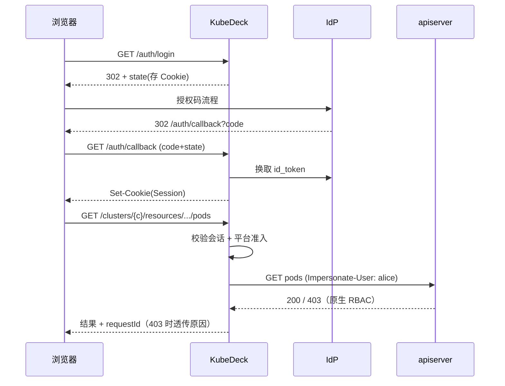
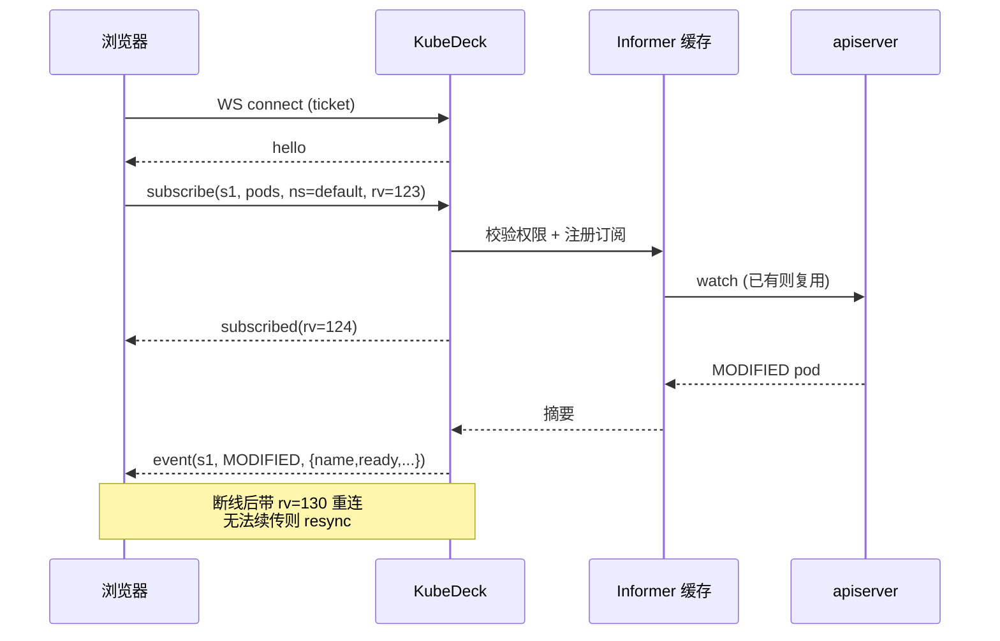
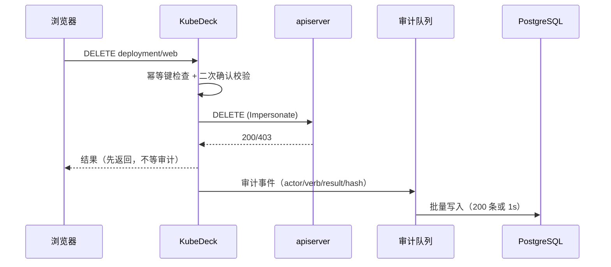

## Context

KubeDeck 为绿地项目，没有历史代码与兼容包袱；但有两个已固化的外部约束：

1. **集群侧不可改造**：目标集群可能由云厂商托管，平台的权限模型、审计与网络方案必须建立在标准 Kubernetes API 之上，不能依赖自研 CRD 或 apiserver 插件。
2. **测试环境已验证**：`verify/` 中的三个最小程序已在 WSL2 + k3s v1.37.2 上跑通 dynamic client、Impersonation 与 exec，client-go 版本锁定为 v0.37.2。验证结论见 [verify/README.md](../../../verify/README.md)，产品级总纲见 [k8s-console-design.md](../../../k8s-console-design.md)。

本设计只回答「怎么实现」，需求边界以 `specs/` 为准，动机以 `proposal.md` 为准。

## Goals / Non-Goals

**Goals:**

- 单二进制交付，无运行时依赖，可私有化部署到客户内网。
- 单集群 1000 节点 / 50k Pod、20 个集群规模下，列表页 P95 < 300ms，且不对 apiserver 造成持续压力。
- 授权行为 100% 由集群原生 RBAC 决定，平台不产生第二套权限规则。
- 所有写操作与敏感操作可追溯到具体用户，审计链可校验。
- 某集群或某个聚合 API 故障时，故障影响被限制在该集群或该资源类型内。

**Non-Goals:**

- 不做集群生命周期管理（装集群、加节点），交给 Cluster API / 云控制台。
- 不做 CRD 的 schema 建模与表单化编辑，CRD 统一走 YAML。
- 不做日志的长期存储与全文检索，大集群引导接入 Loki。
- 不做多租户计费与配额运营，只展示 ResourceQuota 使用率。
- 不在本期实现 Agent 反向隧道，仅保留抽象。

## Decisions

### D1. 后端：Go 1.27 + client-go v0.37，单二进制交付

选择 Go 而非 Python 的核心原因是 client-go 的 informer 缓存与 goroutine 并发模型：日志跟随、实时推送、多集群 watch 都是长连接场景，Python 需要额外维护事件循环与连接生命周期。前端静态资源通过 `go:embed` 打包，交付物只有一个镜像。

**备选**：Python + FastAPI（开发快，但需自建缓存与重连）；Node.js + `@kubernetes/client-node`（生态弱于 client-go）。

### D2. 授权：Impersonation 透传 + SelfSubjectAccessReview 预检

平台维护一个低权限 ServiceAccount，仅授予 `users`/`groups`/`serviceaccounts` 的 `impersonate` 动词与资源发现权限。每个用户请求携带 `Impersonate-User` 与 `Impersonate-Group`，由 apiserver 完成 RBAC 与准入判定。权限预检使用 `SelfSubjectAccessReview`，结果缓存 30 秒（spec 上限 60 秒）。

**为什么不建平台侧权限表**：双份规则必然漂移，且无法覆盖 CRD、聚合 API、Admission 等动态行为。**备选**：集群已配置 OIDC 时直接透传用户 Token（零信任链，作为可选优化，不做默认路径）。

**已实现验证**：未授权 403 → 绑定 Role 后成功 → 跨命名空间 403 → SSAR `allowed=true` 并返回 RoleBinding 原因。

### D3. 资源访问：dynamic client + discovery，而非 typed client

统一用 `dynamic.Interface` 处理内置资源与 CRD，避免为每种类型生成客户端，也避免新增 CRD 支持时改代码。代价是丢失编译期字段类型，由前端按 OpenAPI schema 渲染、未知字段原样展示来补偿。

**关键实现约束（验证中发现）**：`discovery.ServerPreferredResources()` 在任一聚合 API 不可用时会整体失败，必须用 `discovery.IsGroupDiscoveryFailedError` 区分"部分失败"并继续使用部分结果；该行为已写入 `resource-browser` spec 的第一个场景。

**备选**：typed client + 生成代码（类型安全，但 CRD 场景需要代码生成流水线）；`unstructured` 直传（更底层，但缺少便捷访问器）。

### D4. 缓存：metadata-only informer + 按需详情 + 热度懒加载

- 列表页走 `PartialObjectMetadata` 级别的 watch，只保留摘要字段，单对象内存约为完整对象的 1/5–1/10。
- 详情页始终 `GET` 单个对象，不依赖缓存，避免缓存与集群状态不一致。
- 每个集群只订阅页面实际使用的 GVR（pods、deployments、events、nodes 等），不做全量 informer。
- 10 分钟无人访问的集群停止 watch，恢复访问时先 list 再 watch。
- 客户端 QPS/Burst 按集群独立配置，默认 50/100，用限速器保护 apiserver。

**备选**：直连 list（大集群会打爆 apiserver）；全量镜像入库（多一层双写不一致，且放弃实时性）。

### D5. 实时推送：单 WebSocket 多路复用 + 增量 + resync

一条连接承载多个订阅，帧协议为 JSON（`subscribe` / `unsubscribe` / `event` / `resync` / `ping`）。服务端为每个连接维护有界队列，溢出即丢弃增量并要求 `resync`；客户端重连时携带 `lastResourceVersion` 尝试续传。

**备选**：每视图独立 WS（连接数不可控）；SSE（单向够用，但多路复用与终端流需要 WS）；轮询（5000 Pod 规模下持续打 apiserver）。

### D6. 数据存储：PostgreSQL 只存平台元数据，审计按月分区

平台表：`users`、`clusters`、`cluster_credentials`、`roles`、`role_bindings`、`audit_logs`、`operation_templates`、`app_settings`。集群资源状态一律不入库。审计表按 `occurred_at` 月分区，保留 180 天，记录含 `prev_hash`/`hash` 形成哈希链；数据库账号对审计表只有 INSERT/SELECT 权限。

**备选**：资源状态定期同步入库（离线分析友好，但引入双写与陈旧数据）；审计写对象存储（成本低，但查询能力弱）。

### D7. 凭据加密：AES-256-GCM，KEK 置于平台之外

每条凭据独立随机 nonce，密文与 `key_version` 入库；KEK 来自环境变量 / KMS / Vault，绝不入库。轮换时后台任务用旧 KEK 解密、新 KEK 加密，逐条推进，支持中断续跑。API 只返回 `server`、`auth_mode`、指纹与轮换时间。

**备选**：K8S Sealed Secrets（绑定单集群，不适合平台自身多集群管理）；Vault Transit 直接加密（依赖外部服务可用性，作为可选后端）。

### D8. 前端：React 18 + AntD 5 + TanStack Query + Zustand

- 服务端状态全部交给 TanStack Query，WS 增量通过 `setQueryData` 局部更新，不引入全局 store 管理资源列表。
- UI 状态（当前命名空间、列配置、侧栏）用 Zustand。
- 表单用 React Hook Form + Zod，与后端错误结构对齐。
- Monaco 负责 YAML（schema 校验 + diff），xterm.js 负责后续终端，均动态加载。
- 构建用 Vite：产物是纯静态文件，`go:embed` 直接嵌入单二进制、无 Node 运行时；Rollup 对 Monaco/xterm 的 `import()` 自动拆 chunk，保住首屏；dev server 的 `server.proxy` 把 `/api` 与 WS 代理到本地 Go 服务，联调免 CORS。生产构建外链 JS/CSS，满足 `default-src 'self'` 的 CSP 要求。
- 列表超过 200 行启用虚拟滚动；WS 增量按 150ms 批合并。

**备选**：Vue 3 + Element Plus（团队熟悉度决定）；Next.js（本项目无 SEO 与 SSR 需求，反而增加部署复杂度）；构建工具备选 CRA（已停止维护）、手配 Webpack（配置维护成本高且本项目无对应定制需求）、Rspack（React 侧生态成熟度不及 Vite，绿地项目无押注理由）。

### D9. 部署：Helm + 单镜像，无状态多副本

镜像内含后端二进制与前端资源；Deployment ≥2 副本、反亲和、PDB `minAvailable: 1`。后台任务（健康探测、密钥轮换、审计归档）用 Lease 选主。依赖 PostgreSQL 15+、Redis 7+（可选）、Ingress + TLS。平台自身 SA 只绑定 `impersonate` ClusterRole。

**备选**：前后端分离部署（大团队可选，已保留支持）；Operator 形态（本项目不需要管理 CRD，收益低）。

### D10. 多集群访问：`ClusterTransport` 抽象

```
ClusterTransport
├── DirectTransport   // 本期：服务端直连 apiserver
└── AgentTransport    // 后续：Agent 出站 WSS + 帧转发
```

上层只依赖 `ClusterTransport` 提供的 `rest.Config` 与健康状态，新增 Agent 模式不改领域层。这是唯一为未来预留的抽象，其余部分不做过度设计。

### D11. 错误模型与降级

统一错误响应 `{code, message, details, requestId}`，把 apiserver 的 `Status` 映射为稳定错误码（`FORBIDDEN`、`CONFLICT`、`NOT_FOUND`、`CLUSTER_UNREACHABLE`、`DEGRADED`）。降级优先级：缓存数据 > 明确错误 > 超时；任何视图都不允许无限等待。

### D12. 版本兼容：窗口 1.34–1.37，硬地板 1.24，运行时按 discovery 适配

- **支持窗口**：client-go v0.37.2 按上游偏移策略（官方承诺兼容至 n-3 的 apiserver）支持 1.34–1.37。MVP 仅接入窗口内集群：接入探测读取 `GET /version`，版本低于 1.34 时返回 400 并说明最低支持版本。高于窗口上界的新集群不做硬拒绝（稳定 API 向后兼容，差异由 discovery 适配吸收），但不列入矩阵承诺。
- **硬地板 1.24**：平台依赖的 typed API 在 1.24 已全部 GA（`authorization.k8s.io/v1` SSAR、`policy/v1` Eviction、`events.k8s.io/v1`、`batch/v1` CronJob），metadata-only informer 亦已稳定。这是永不放宽的下界；1.25–1.33 未来若放开，只能以「未验证集群」软门禁接入，且需先纳入验证矩阵。
- **运行时不做版本分支**：某能力是否可用由 discovery 结果决定——GVR 缺失走 resource-browser 既有的「资源不存在」语义，字段级差异由 OpenAPI schema 渲染与未知字段透传吸收。这是 D3 选 dynamic client 的直接收益，代码中不出现 `if version >= x.y` 式分支。
- **版本即数据**：版本在接入探测与健康检查时读取，存入 `clusters.server_version`，集群列表展示。
- **矩阵靠实测**：兼容矩阵不靠宣称——`verify/` 三个程序在窗口两端（k3s 1.37 与 1.34）各跑一遍，结果写入发布说明；client-go 升级跟随「必须支持的最老集群」，任何升级必过全矩阵。

## Risks / Trade-offs

| 风险 | 影响 | 缓解 |
|---|---|---|
| 平台 SA 的 `impersonate` 权限过强 | 被攻破后可冒充任意用户 | SA 仅此一项权限；NetworkPolicy 限制出站；所有代请求带 `requestId` 入审计；Keycloak 侧启用 MFA |
| informer 内存随集群规模增长 | 20 集群 × 5 万 Pod 可能超过单实例内存 | metadata-only、只订阅必要 GVR、10 分钟空闲停止、单实例集群数上限可配 |
| `ServerPreferredResources` 部分失败 | 资源目录整体不可用（已验证会复现） | 强制使用 `IsGroupDiscoveryFailedError` 分支，UI 标注受影响 API 组 |
| 大规模日志跟随压垮服务端 | 连接与带宽耗尽 | 每用户连接配额、单次日志上限、空闲断开、按集群限速 |
| 审计写入拖慢写请求 | 写操作延迟上升 | 审计事件异步批插；审计失败不阻塞业务，但记录到本地补偿队列 |
| PostgreSQL 故障 | 登录与写操作不可用 | 读路径不依赖 PG（informer 缓存 + 会话缓存）；写操作返回 503 并明确提示 |
| Windows↔WSL 网络不稳定（开发环境） | 本地联调偶发连接失败 | 验证与 CI 均在 Linux/容器内执行；不依赖宿主机端口转发 |
| 版本漂移（client-go vs apiserver） | 新 API 不可用或字段缺失 | 窗口 1.34–1.37、低于即拒（D12）；运行时按 discovery 适配，无版本分支；兼容矩阵由 verify/ 在窗口两端实测产出 |

## Migration Plan

绿地项目，无存量数据迁移。上线路径：

1. **Phase 0**：部署单集群实例，仅启用只读资源浏览与登录，验证 Impersonation 在生产集群的权限边界。
2. **Phase 1**：开启写操作与审计，先在非生产集群试运行 1–2 周。
3. **Phase 2**：开启实时推送与日志跟随，按集群逐步放量。
4. **回滚**：Helm `helm rollback` 回到上一版本；平台无状态，回滚不影响目标集群资源；审计表向后兼容，仅新增列。

数据库变更使用向前兼容的 expand/contract 策略：先加列、双写、再切读、最后删列。

## Open Questions

以下问题不影响 spec、架构与任务拆分，可在实施前确定：

1. **OIDC IdP 选型**：Keycloak / Dex / 企业现有 IdP / 飞书。只影响部署配置与登录跳转参数。
2. **是否引入 Redis**：单副本小规模部署可省略（会话改用签名 Cookie、限流退化为本地令牌桶）。影响部署复杂度，不影响接口。
3. **审计保留期**：默认 180 天，是否满足合规要求由使用方确认，作为可配置项。
4. **大集群日志方案**：是否强制接入 Loki，取决于目标集群的日志量，可在压测后决定。
## API 契约

完整接口清单见 [k8s-console-design.md 附录 D](../../../k8s-console-design.md#附录-d完整-api-清单)，此处只固定实现层面的约定：

- **路径**：`/api/v1/clusters/{cluster}/...`，资源统一用 `{group}/{version}/{resource}` 而非 Kind；
- **错误**：所有非 2xx 返回 `{code,message,details,requestId}`，`code` 取自附录 E 的枚举；
- **分页**：列表统一 `limit` + `continue`，响应带 `continue` 与 `remainingItemCount`；
- **幂等**：写操作接受 `Idempotency-Key`，Redis 保存 24 小时结果（无 Redis 时退化为进程内，单副本可用）；
- **一致性**：列表默认读 informer 缓存，`?consistency=strong` 强制直连 apiserver；
- **权限**：每个 handler 在入口执行一次 `SelfSubjectAccessReview` 语义的校验，不依赖路由级中间件「一刀切」。

### 接口与能力的对应

| 能力 | 主要接口 |
|---|---|
| `cluster-registry` | `/clusters`、`/clusters/{c}/health`、`/clusters/{c}/credential` |
| `identity-access` | `/auth/*`、`/auth/can`、`/role-bindings` |
| `resource-browser` | `/clusters/{c}/api-resources`、`/clusters/{c}/resources/...` |
| `workload-control` | `/clusters/{c}/workloads/...`、`/clusters/{c}/pods/...` |
| `log-and-events` | `/clusters/{c}/pods/{ns}/{name}/log`、`/clusters/{c}/events` |
| `realtime-stream` | `WS /clusters/{c}/stream` |
| `audit-log` | `/audit-logs`、`/audit-logs/export`、`/audit-logs/verify` |
| `web-console` | 无独立接口，消费以上全部 |

## 数据模型映射

| 表 | 用途 | 关键约束 | 对应能力 |
|---|---|---|---|
| `users` | 平台用户（OIDC 同步） | `subject` 唯一 | identity-access |
| `clusters` | 集群登记与状态 | `name` 唯一；`status` 可索引 | cluster-registry |
| `cluster_credentials` | 加密凭据 | `(key_version)` 索引；密文与 nonce 分离 | cluster-registry |
| `roles` | 平台角色（预置） | `code` 唯一 | identity-access |
| `role_bindings` | 用户 × 集群 × 命名空间 × 角色 | 四元组唯一 | identity-access |
| `audit_logs` | 操作审计 | 月分区；只追加；哈希链 | audit-log |
| `operation_templates` | 操作模板（后续） | 作用域枚举 | workload-control |
| `app_settings` | 平台配置 | 单行键值 | 平台 |

不建表的数据：集群资源状态、informer 缓存、会话（Redis）、幂等键（Redis）。

## 关键时序

### 登录后的代请求



### 实时订阅



### 写操作与审计



## 性能预算

| 操作 | 目标 | 测量方式 |
|---|---|---|
| 列表（缓存命中） | P95 < 300ms | 压测 + Prometheus histogram |
| 详情（直连 apiserver） | P95 < 500ms | 同上 |
| 写操作（不含审计落库） | P95 < 800ms | 同上 |
| WS 事件端到端 | P95 < 1s | 注入变更并打点 |
| 日志首字节 | P95 < 1.5s | 同集群内测 |
| 登录回调 | P95 < 1s | 排除 IdP 耗时 |

预算超标时的第一处置：先查 informer 同步延迟与 apiserver 限速，再考虑加副本。

## 测试策略

| 层级 | 范围 | 工具 / 环境 |
|---|---|---|
| 单元 | 错误映射、幂等、加密、哈希链、参数校验 | `go test`，无外部依赖 |
| 集成 | 仓储、RBAC 绑定、SSAR、审计写入 | 真实 PostgreSQL + k3s |
| 端到端 | 登录→接集群→浏览→写操作→审计 | k3s + 浏览器自动化 |
| 压测 | 列表/WS/日志在大规模数据下的表现 | 生成 50k Pod 的模拟集群 |
| 安全 | 越权、CSRF、XSS、SSRF、凭据泄露 | 清单 + 手工渗透 |

既定事实：`verify/` 的三个程序就是端到端的第一层，Phase 0 必须保持它们常绿。
